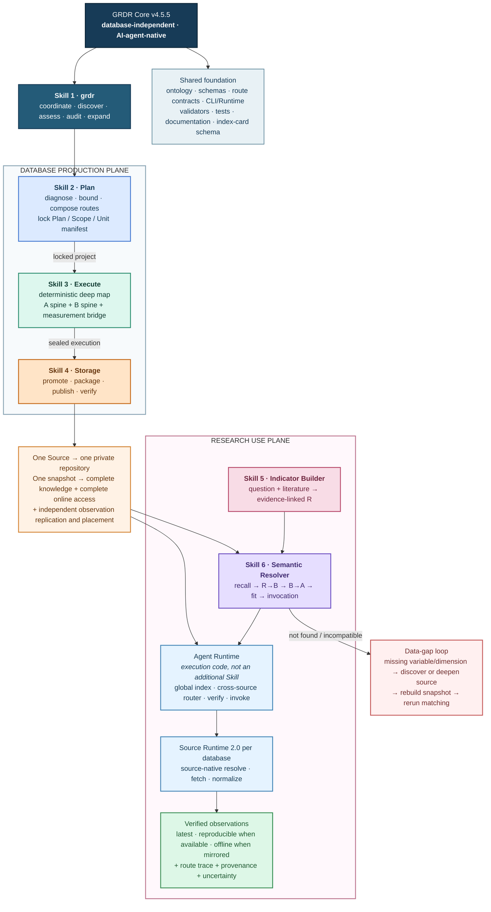
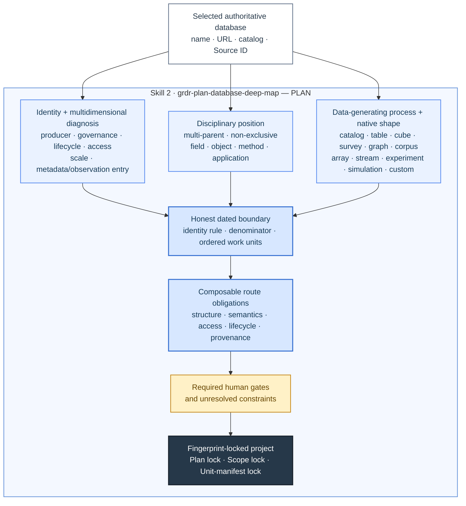
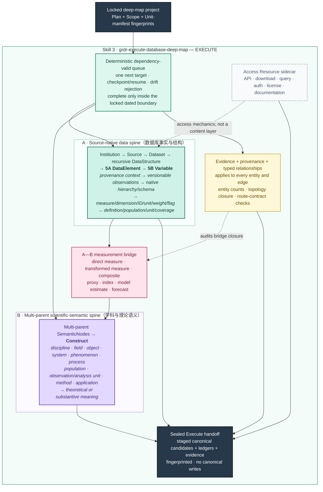

# GRDR Core

GRDR Core is the database-independent engine for the Global Research Data Registry: an AI-agent-native, all-discipline infrastructure for data-source registration, deep mapping, research matching, and distributed snapshot storage.

> **Current stable release / 当前稳定版本：[`v4.5.5`](https://github.com/yangyuezh/grdr-core/releases/tag/v4.5.5)**
> This is the actively maintained Core line. The stable repository name remains `grdr-core`; exact auditable states are identified by immutable version tags, GitHub Releases, commit hashes, and the `VERSION` file. The separately preserved `grdr-core-v4.0` repository is a frozen v4.0.1 product archive, not the current Core.

This repository contains no database snapshot, database-specific adapter, canonical source record, source-archive card, project state, or observation data. Mutable registry and project state lives under external `GRDR_STATE_ROOT`; every selected database is stored in its own private source repository.

## Three-step database factory

GRDR Core fixes the workflow as three independent, Agent-callable Skills:

1. `grdr-plan-database-deep-map` diagnoses an unknown database, defines its bounded work-unit universe, composes route obligations, and fingerprint-locks the Plan.
2. `grdr-execute-database-deep-map` follows the deterministic queue, reconstructs native structure and disciplinary semantics, builds the DataElement → Variable → Construct bridge, and seals the execution without canonical writes.
3. `grdr-store-database-deep-map` transactionally promotes sealed records, inherits the locked knowledge scope, completes and tests online access for every registered Variable, independently chooses full, partitioned, or no observation replication, publishes the callable knowledge and Runtime artifacts, verifies every declared location, writes the central source card, and issues the final Storage receipt.

These three Skills are the database production plane. The independent GRDR Agent Runtime is the use plane: its external, rebuildable Global Index & Routing Layer incrementally indexes central records and the latest source snapshots, performs cross-source candidate recall, opens only selected source indexes, and dispatches one Variable to its source-specific Runtime 2.0. Snapshot verification, policy-ordered invocation, and fallback remain Runtime operations. Storage packages and tests each source runtime and writes the central card that invalidates the derived global index; it does not own unified search, matching, or retrieval behavior.

## Research use plane

GRDR has six formal Skills in total. `grdr` is the coordinator; the three Skills above produce database snapshots; `grdr-indicator-builder` converts a research question and literature into evidence-linked leaf indicators; and `grdr-resolve-research-semantics` persists the missing R→B entry bridge, traverses the stored B→A graph, evaluates variable fit, explains every selected route, and invokes the verified local, mounted, or official observation route through the source runtime. Agent Runtime and source-specific runtimes are versioned execution code rather than additional Skills.

## Core architecture

The complete architecture is shown in three linked views so that every element remains readable at normal GitHub width: the system overview, the database production plane, and the research use plane. The production view is divided into Plan, Execute, and Storage panels without changing the single three-step workflow.

### 1. End-to-end system overview



### 2. Database production plane: Plan → Execute → Storage

#### 2A. Plan — 诊断、定界、路线组合与三重锁定



#### 2B. Execute — 两根主干、一座桥梁和确定性执行



#### 2C. Storage — 知识、在线调用、观测复制三轴独立，位置清单和最终回执

```mermaid
flowchart TB
        SEALED["Sealed Execute handoff<br/>staged candidates + ledgers + evidence<br/>fingerprinted · no canonical writes"]:::handoff

        subgraph STORAGE["Skill 4 · grdr-store-database-deep-map — STORAGE"]
            direction TB
            S_PROMOTE["Transactional external-state promotion<br/>audit sealed execution · Core remains byte-identical"]:::storage
            S_PROFILE["Three independent snapshot axes<br/><b>knowledge scope</b> inherited from Plan<br/><b>online access</b> complete for every registered Variable<br/><b>observation replication + placement</b> decided by Storage"]:::storageStrong
            S_CAPACITY["GitHub capacity assessment<br/>measure bytes before copying · optional upstream estimate<br/>5 GiB observation total · each asset strictly below 2 GiB<br/><i>size never reduces knowledge depth</i>"]:::storage
            S_ONLINE["Universal online-callability gate<br/>official API · official bulk download · browser automation<br/>or GRDR Release snapshot fallback<br/><b>100% registered Variables must have an executable route</b>"]:::online
            S_ACCEPT["Core → Source Runtime invocation acceptance<br/>real Variable + country/period parameters + output artifacts<br/><b>latest required · offline required when available</b>"]:::verify
            S_PACKAGE["Build one source-scoped callable snapshot<br/>knowledge graph + Execute project + standards/evidence<br/>Agent SQLite index + source Runtime 2.0"]:::storageStrong
            S_MODES["Independent observation replication<br/><b>full mirror</b> · <b>partitioned mirror</b> · <b>no mirror</b><br/>capacity affects copied bytes only"]:::storage

            S_REPO["Private source Git repository<br/>Core version reference · config · adapters · runtime code<br/>Plan · manifests · README · tests · archive receipts"]:::artifact
            S_RELEASE["GitHub Release · compressed distribution<br/><b>knowledge/ + agent/ always</b><br/>observations only when explicitly placed here"]:::artifactStrong
            S_LOCAL_CACHE["Two-scope derived local cache<br/><b>agent</b>: lightweight index + Runtime (default)<br/><b>full</b>: knowledge + Agent + Release observations (explicit)<br/><i>disposable · rebuildable · never canonical</i>"]:::artifact
            S_LARGE["Large-data placement<br/>mounted object store / large disk<br/>partition inventory + SHA-256"]:::artifact
            S_UPSTREAM["Official online routes<br/>API · bulk-download adapter · browser-automation adapter<br/>tested route coverage + explicit availability state"]:::external
            S_CACHE["Use-plane derivative after Storage<br/>on-demand research-project data snapshot<br/>source/snapshot/Variable/arguments/hashes"]:::artifact
            S_ONLINE_MANIFEST["Online access manifest + audit<br/>latest + explicit reproducibility status + offline policy<br/>route result + every Variable → one or more route IDs"]:::verify
            S_MANIFEST["Location-aware replication manifest<br/>every copied logical file → exact locations + SHA-256<br/><b>knowledge never contains raw observations</b><br/>no logical file appears in two packages accidentally"]:::verify
            S_VERIFY["Read-back publication verification<br/>repository · tag → exact commit · every asset hash<br/>upload + read back final Storage receipt"]:::verify
            S_RECEIPT["Receipt verified remotely, then sealed locally<br/><b>versioned_database_snapshot</b>"]:::handoff
            S_CARD["External GRDR state source-archive card<br/>Source ID · repository · snapshot · Release<br/>fingerprint · completion status"]:::shared

            SEALED --> S_PROMOTE --> S_PROFILE
            S_PROFILE --> S_ONLINE --> S_ACCEPT --> S_PACKAGE
            S_PROFILE --> S_CAPACITY --> S_PACKAGE
            S_CAPACITY --> S_MODES
            S_PACKAGE --> S_REPO
            S_PACKAGE --> S_RELEASE
            S_RELEASE -. "auto-materialize Agent shard; full only on request" .-> S_LOCAL_CACHE
            S_MODES -. "optional observation placement" .-> S_RELEASE
            S_MODES --> S_LARGE
            S_ONLINE --> S_UPSTREAM
            S_ONLINE --> S_ONLINE_MANIFEST
            S_ACCEPT --> S_ONLINE_MANIFEST
            S_RELEASE --> S_MANIFEST
            S_RELEASE -. "verified online fallback when declared" .-> S_ONLINE_MANIFEST
            S_LOCAL_CACHE -. "verified against Release manifest" .-> S_MANIFEST
            S_LARGE --> S_MANIFEST
            S_UPSTREAM --> S_ONLINE_MANIFEST
            S_REPO --> S_VERIFY
            S_MANIFEST --> S_VERIFY
            S_ONLINE_MANIFEST --> S_VERIFY
            S_VERIFY --> S_RECEIPT --> S_CARD
            S_CARD -. "later Agent query" .-> S_CACHE
        end

        GLOBAL_DERIVED["Agent Runtime derived state after Storage<br/>central-card change → incremental global-index refresh<br/><b>rebuildable · non-canonical · outside Core</b>"]:::runtime
        S_CARD -. "invalidates/refreshes use-plane index" .-> GLOBAL_DERIVED

    classDef shared fill:#E8F1F5,stroke:#5E879A,color:#173B57,stroke-width:1.5px;
    classDef handoff fill:#263849,stroke:#17212B,color:#FFFFFF,stroke-width:2px;
    classDef storage fill:#FFF0DF,stroke:#D48638,color:#69370F,stroke-width:1.5px;
    classDef storageStrong fill:#FFE0BF,stroke:#C56A1B,color:#69370F,stroke-width:2px;
    classDef online fill:#E5F3FF,stroke:#397DAA,color:#173B57,stroke-width:2px;
    classDef artifact fill:#FFF7ED,stroke:#D48638,color:#69370F,stroke-width:1.5px;
    classDef artifactStrong fill:#FFEAD4,stroke:#C56A1B,color:#69370F,stroke-width:2px;
    classDef external fill:#FFFFFF,stroke:#64748B,color:#263849,stroke-width:1.5px;
    classDef verify fill:#E7F6EC,stroke:#4D9B63,color:#204F2D,stroke-width:2px;
    classDef runtime fill:#E5F3FF,stroke:#4787B8,color:#173B57,stroke-width:2px;
    style STORAGE fill:#FFFAF3,stroke:#D99A5D,stroke-width:1.5px
```



#### 2D. 不同规模数据库的统一处理规则

数据库规模只影响**原始观测数据复制多少、复制到哪里**，不得降低知识解析深度，也不得降低在线调用要求。无论数据库通常被称为小型、中型还是大型，GRDR 都必须在 Plan 锁定、Execute 验证的知识范围内完整保存数据库结构、变量语义、方法证据；同时必须为全部已登记 Variable 建立并实际测试在线执行路径。这里的“完整”始终对应快照中明确声明的 `knowledge_scope`，不能把局部样本冒充整个上游数据库。

“小型／中型／大型”是当前部署容量策略根据字节数计算出的可调建议，不是数据库固有身份。实际快照保存三个互不替代的判断轴：Plan 继承的 `knowledge_scope`；覆盖全部已登记 Variable 的 `online_access`；Storage 选择的 `observation_replication` 及其物理 `placements`。`capacity_assessment` 只约束第三轴，保存当时的阈值、测量字节数、估计依据、分类和决策。以后硬件升级只需调整外部参数，不需要修改 Skill，也不需要重定义数据库的知识或在线能力。

当前只保留两个容量边界：一个控制单数据库 Release 中观测资产的总量，另一个是 GitHub 单资产平台硬限制。外部 Elements 磁盘不再是配置边界或完成条件。

| 参数 | 当前默认值 | 超过后的实际行为 | 是否可调 |
|---|---:|---|---|
| `github_release_observation_max_bytes` | 5 GiB | 不允许把该快照的观测数据配置到 GitHub Release；知识和 Agent 制品仍照常发布 | 是 |
| `github_release_asset_max_bytes` | 严格低于 2 GiB／文件 | 任何知识、Agent 或观测 Release 文件超限都必须重新分包，不能发布 | 只能调低，不能超过平台上限 |

默认推荐分类为：不超过 GitHub 观测总量阈值时属于“Release 可完整复制”；超过时属于“需要分区、挂载存储或不复制”。分区镜像或不复制观测值的快照如果没有可靠的上游总体量估计，则分类明确记为 `unknown`，不会用已经复制的局部数据量冒充整个数据库规模。小型／中型／大型只保留为面向人的描述，不再驱动不同工程合同。

| 内容或能力 | 所有数据库的硬性规则 | 常见小型数据库 | 常见中型数据库 | 常见大型或持续更新数据库 |
|---|---|---|---|---|
| 机构、发布者与数据源身份 | 在锁定范围内完整保存，并保留官方来源和版本证据 | 完整保存 | 完整保存 | 完整保存 |
| 数据集目录与包含关系 | 完整保存 Dataset 及其父子、版本和派生关系 | 完整保存 | 完整保存 | 完整保存 |
| 数据库原生结构 | 完整保存表、目录、主题、立方体、序列、文件、字段等递归 `DataStructure` | 完整保存 | 完整保存 | 完整保存 |
| 5A 数据元素 | 完整保存指标、测度、维度、标识符、单位、权重、状态标记和派生元素 | 完整保存 | 完整保存 | 完整保存 |
| 5B 变量 | 完整保存定义、总体、观察单位、分析单位、时间、地理和适用范围 | 完整保存 | 完整保存 | 完整保存 |
| 学科语义与理论构念 | 完整保存多父节点 B 主干、Construct 和适用学科语境 | 完整保存 | 完整保存 | 完整保存 |
| A—B 映射桥梁 | 完整保存 DataElement → Variable → Construct 的可追溯关系 | 完整保存 | 完整保存 | 完整保存 |
| 方法、口径、质量与证据 | 完整保存方法说明、分类标准、修订、限制、来源和证据定位 | 完整保存 | 完整保存 | 完整保存 |
| 访问方式 | 作为 Resource 侧车保存 API、下载、查询器、许可和访问约束，不占用内容层级 | 完整保存 | 完整保存 | 完整保存 |
| 官方在线调用 | 必须建设并实测；API、整表下载或浏览器操作均由来源专属 Runtime 适配 | 全部已登记变量可在线调用 | 全部已登记变量可在线调用 | 全部已登记变量可在线调用 |
| GRDR 在线后备 | 官方源不可用时，允许用经核验的 GRDR GitHub Release 快照提供在线路径；仍必须明确官方状态 | 按需 | 按需 | 按需 |
| Agent 知识制品 | 必须保存知识图谱、Agent SQLite 索引、变量访问计划、Runtime 2.0、在线清单和在线审计 | 完整保存 | 完整保存 | 完整保存 |
| 原始观测数据复制 | 只允许由观测策略决定；不得混入 `knowledge/` | 通常完整镜像 | 完整镜像或按年份、国家、主题等分区镜像 | 通常保留在官方上游，按需调用；条件允许时仍可镜像 |
| 未复制的原始观测数据 | 不影响在线调用硬门；必须仍有已测试的官方或 GRDR Release 在线执行路径 | 通常没有 | 常见于未镜像分区 | 常见于不复制或未镜像分区 |
| 研究项目数据快照 | 按需把一次查询的参数、结果、来源快照、变量 ID 和哈希封存到研究项目 | 可选 | 推荐 | 推荐 |
| 完整性声明 | 必须分别声明知识边界、在线变量覆盖率、观测复制边界及其依据 | 三轴分别声明 | 三轴分别声明 | 三轴分别声明 |

因此，大型数据库不是“少解析一部分”或“少打通一部分”，而是**完整理解、完整打通在线调用以后，不重复搬走全部数值**。中型数据库也不必强制复制；大型数据库如果实际上能够完整复制，也可以选择完整镜像。

##### 三种原始观测数据复制模式

| 复制模式 | 适用判断 | 规范快照复制多少观测值 | 允许的复制位置 | 强制完整性声明 | 与在线调用的关系 | 完成前必须核验 |
|---|---|---|---|---|---|---|
| `full_mirror` 完整镜像 | 锁定范围内的全部观测文件能够复制和持续管理，且所选物理位置没有超过其配置阈值 | 声明范围内全部复制 | GitHub Release；必要时可另声明挂载对象存储 | `complete_within_knowledge_scope` | 不替代在线调用；最新数据默认仍先尝试官方在线路径 | 权威文件分母、预期与实际文件数、实际字节数、逐文件 SHA-256、所选位置和容量策略 |
| `partitioned_mirror` 分区镜像 | 只复制明确且有研究价值的年份、国家、主题或其他分区 | 仅复制分区清单中声明的完整分区 | GitHub Release或挂载对象存储 | `complete_declared_partition_set` | 不替代在线调用；镜像可用于复现、离线或失败回退 | Schema 有效的分区清单；每个分区的边界、名称、成员路径、大小、SHA-256；预期与实际分区数和文件数完全一致 |
| `no_mirror` 不复制 | 观测值整体复制不合理、持续更新，或当前容量策略不允许复制 | 规范快照不复制原始观测文件 | 无观测复制位置；知识与 Agent 制品仍正常发布 | `observations_not_replicated` | 在线调用仍是硬性要求，不能用“不复制”豁免变量覆盖 | 观测输入为零、复制位置为零；在线审计仍覆盖全部已登记变量 |

选择顺序是：先锁定并完成同等深度的知识解析；为每个已登记 Variable 建立并实测在线路径；再根据观测数据的实际体量、分区性、更新频率和可维护性独立选择复制模式。不得用“数据库很大”缩减知识或在线覆盖，也不得把未复制的数据写成已经镜像。

##### 在线调用完成规则与路由优先级

在线调用不是观测复制模式。Storage 必须生成 `online_access.json`、`online_runtime_audit.json` 和 `invocation_acceptance_audit.json`。前两份文件记录路线声明、自检结果和每个已登记 Variable 对应的可执行 `route_id`；第三份文件必须通过 Core 的标准 `fetch-variable` 协议，用真实 Variable 和国家／时期参数取回非空观测值及输出文件。`latest` 路线必须验收；存在离线路线时还必须验收 `offline`。只有变量覆盖为零缺口且参数化调用门禁通过，快照才能达到 `callable_complete`。

| 官方数据库形态 | Runtime 适配方式 | 能否达到在线完成 | 关键验收 |
|---|---|---|---|
| 官方 API／查询接口 | 参数化 API 适配器 | 能 | Core 标准国家／时期参数实际请求成功、返回非空观测和可核验产物、全部变量有路线 |
| 只能下载整表或压缩包 | 下载、校验、解包、筛选适配器 | 能 | 官方文件可取、哈希／版本可证，并通过 Core 参数筛选得到非空结果 |
| 只能通过网页操作 | 浏览器自动化适配器 | 能，但稳定性要求更高 | 实际流程可重复、选择参数可记录、产物可核验，并通过参数化调用门禁 |
| 官方在线源暂时不可用 | 经核验的 GRDR GitHub Release 快照路线 | 能作为在线后备 | 官方状态明确记为 `unavailable`，Release 路线覆盖全部变量 |
| 既无可执行官方路线，也无 GRDR 在线后备 | 无 | 不能 | Storage 必须阻止完成，不能只靠本机文件冒充在线可调用 |

Agent Runtime 支持三种明确的路由策略：

| 路由策略 | 目的 | 默认顺序 |
|---|---|---|
| `latest` | 获取当前可用数据 | 官方在线 → GRDR GitHub Release 在线后备 → 已物化本地缓存／挂载镜像 |
| `reproducible` | 优先复现已经冻结的结果 | GRDR／来源版本化快照 → 已物化本地缓存／挂载镜像 → 版本可核验的官方路线 |
| `offline` | 无网络环境 | 已物化本地缓存／挂载镜像；若没有可用复制则明确失败 |

每次调用都把候选顺序、失败路线和最终选中路线写入结果；第一条路线失败时 Runtime 自动尝试下一条，而不是静默改用来源不明的数据。

`latest` 路线及其全部 Variable 覆盖始终是完成条件。若存在冻结、版本化或镜像路线，`reproducible` 会直接给出来源级复现路径。若快照选择 `no_mirror` 且官方接口只能返回当前数据，Storage 可以完成，但必须将 `reproducibility.status` 明确记录为 `research_snapshot_required`，不得虚构来源级冻结路线；研究时先按 `latest` 取数并封存研究项目数据快照，之后依靠该快照复现。此例外只适用于已启用按需研究快照的 `no_mirror`，不削弱知识完整性、在线全变量覆盖或真实调用验收。

##### 三个工程标准分别解决什么

它们不是新增 Skill，而是现有 Skills 和运行程序共同遵守的统一格式。

| 工程标准 | 通俗含义 | 直接解决的问题 |
|---|---|---|
| Variable 操作化元数据 Schema | 每个变量使用同一张“说明卡”，填写测量定义、总体、观察单位、单位与分母、时间和空间粒度、测量方法及证据 | 防止只按变量名称匹配；让 R→B→A 匹配能够逐项判断人口、单位、时间和空间是否合适 |
| 在线路线清单 Schema | 每个来源把 API、整表下载、网页自动化、冻结 Release 等路线按同一格式登记，并给每个 Variable 指定已测试路线 | 防止 Agent 盲试错误接口；调用前即可按变量筛掉无关路线 |
| Source Runtime 协议 | 规定 Core 如何向每个数据库专用适配器传入 Variable、参数、路线和输出目录，以及适配器必须返回什么 | 让不同结构、不同学科、不同访问方式的数据库都能插入同一个 GRDR 调用流程 |

##### 知识、观测与备份的关系

`knowledge/` 与 `observations/` 在逻辑上必须彻底分离，但通过 Source ID、Snapshot ID、Dataset／Variable ID、位置清单和 SHA-256 精确连接。在线路线另由 `online_access.json` 连接到同一个 Variable。Agent 的标准调用顺序是：检索知识索引 → 解析变量和访问计划 → 按路由策略依次尝试在线或复制路线 → 获取数值 → 必要时封存研究项目数据快照。

- 原始观测文件不得同时混入知识包和观测包；跨逻辑包出现相同内容哈希时，Storage 必须失败。
- 同一观测资产可以在 GitHub Release 或明确声明的挂载对象存储中保留经过核验的规范镜像；本地缓存只由 Release 物化，可随时删除重建。默认 `agent` scope 只保留源级 SQLite、Runtime、路线审计与回执；显式 `full` scope 才展开知识和 GitHub 观测资产。物理副本数量不会改变数据本身的统计准确性。
- `location-aware manifest` 必须记录每个逻辑文件的实际位置和哈希，使 Agent 能确认不同位置对应同一快照，而不是两个互相冲突的版本。
- `online_access.json` 与 `online_runtime_audit.json` 必须分别证明路线定义和实际变量覆盖；它们不能由本地镜像清单替代。
- 研究项目缓存是带查询范围和来源证据的派生快照，不得冒充数据库的规范观测镜像。

### 3. Research use plane: R → B → A → verified observation route

```mermaid
flowchart TB
    QUESTION["Research question / topic<br/>population · unit · time · geography · intended inference"]:::research
    LITERATURE["Optional substantial literature corpus<br/>abstract · introduction · methods · results<br/>discussion · conclusion · references"]:::research
    BUILDER["<b>Skill 5 · grdr-indicator-builder</b><br/>theory deduction · content analysis · grounded coding<br/>evidence-linked multi-level indicator construction"]:::researchStrong
    R_TREE["R · ResearchProject + hierarchical ResearchIndicators<br/>domain → construct → subconstruct → indicator<br/>→ leaf operational requirement"]:::rNode
    HUMAN["Explicit human gates when required<br/>corpus boundary · indicator framework · contested mappings"]:::gate

    QUESTION --> BUILDER
    LITERATURE --> BUILDER
    HUMAN -. "human decision; never Agent self-approval" .-> BUILDER
    BUILDER --> R_TREE

    SNAPSHOT["Canonical distributed source snapshots<br/>central cards + source Agent indexes + Runtime 2.0<br/>verified Releases + exact fingerprints"]:::runtime
    GLOBAL_INDEX["<b>Core Agent Runtime · Global Index</b><br/>1 incremental cross-source index · 2 global candidate recall<br/>3 two-stage source selection<br/><i>external derived state · rebuildable · not a Skill</i>"]:::globalRuntime
    GLOBAL_ROUTE["<b>Core Agent Runtime · Global Router</b><br/>4 Variable → Source → Snapshot → route IDs<br/>selected source shard only"]:::globalRuntime

    subgraph FIVE["Skill 6 · grdr-resolve-research-semantics — persisted five-layer resolver"]
        direction LR
        RECALL["1 · Full-text candidate recall<br/>Construct · SemanticNode · Variable<br/><i>latest callable by default · history only when explicit<br/>candidate ≠ conclusion</i>"]:::resolver
        ALIGN["2 · Evidence-constrained R→B<br/>exact · close · broader · narrower<br/>related · no-match"]:::resolver
        TRAVERSE["3 · Auditable B→A traversal<br/>SemanticNode / Construct → Variable<br/>→ DataElement → DataStructure → Dataset → snapshot"]:::resolver
        FIT["4 · Variable-fit classification + explanation<br/>construct · population · unit · time · space<br/>direct · transformed · composite · proxy · conflict"]:::resolver
        INVOKE["5 · Indicator-scoped invocation<br/>locate/mount verified snapshot<br/>resolve source-native access plan"]:::resolverStrong
        RECALL --> ALIGN --> TRAVERSE --> FIT --> INVOKE
    end

    R_TREE --> RECALL
    SNAPSHOT -. "source-card or registry change refreshes derived index" .-> GLOBAL_INDEX
    GLOBAL_INDEX -->|"global B/A candidates"| RECALL
    HUMAN -. "approve contested decisions" .-> FIT

    SOURCE_RUNTIME["Source Runtime 2.0 · selected database only<br/>verified adapter + exact snapshot + access plan"]:::runtime
    ROUTER["Policy-aware observation router<br/>latest · reproducible · offline<br/>ordered attempts + explicit fallback trace"]:::runtime
    LOCAL["Verified optional local cache<br/>materialized Release observations"]:::local
    MOUNTED["Verified mounted mirror<br/>object store / large disk"]:::local
    RELEASE_ROUTE["Verified GRDR online fallback<br/>GitHub Release observation snapshot"]:::runtime
    UPSTREAM["Authoritative upstream route<br/>official API · file · query service"]:::external
    RESULT["Research-ready output<br/>data + source + snapshot + Variable<br/>alignment/path + provenance + uncertainty"]:::result
    GAP["Data-gap diagnosis<br/>missing construct · variable · population · unit<br/>time · space · modality · joinability"]:::gap
    EXPAND["Expansion and rerun<br/>discover or deepen source → Plan → Execute → Storage<br/>→ rebuild recall/alignment/path → rerun matching"]:::shared

    INVOKE --> GLOBAL_ROUTE -->|"open selected source shard"| SOURCE_RUNTIME --> ROUTER
    GLOBAL_INDEX -. "exact entity locators" .-> GLOBAL_ROUTE
    ROUTER -->|"official_online"| UPSTREAM --> RESULT
    ROUTER -->|"github_release_snapshot"| RELEASE_ROUTE --> RESULT
    ROUTER -->|"local_snapshot_cache"| LOCAL --> RESULT
    ROUTER -->|"mounted_object_store"| MOUNTED --> RESULT
    FIT -->|"not_found_registry_snapshot / incompatible"| GAP --> EXPAND

    classDef research fill:#FDECF1,stroke:#C76884,color:#6E243D,stroke-width:1.5px;
    classDef researchStrong fill:#F8D8E3,stroke:#B84A6C,color:#6E243D,stroke-width:2px;
    classDef rNode fill:#FFF0F5,stroke:#C4557B,color:#6E243D,stroke-width:2px;
    classDef gate fill:#FFF1C7,stroke:#C78A1D,color:#664500,stroke-width:1.5px;
    classDef resolver fill:#EEE9FF,stroke:#7B62C5,color:#3F2A72,stroke-width:1.5px;
    classDef resolverStrong fill:#DED3FF,stroke:#6646B7,color:#3F2A72,stroke-width:2px;
    classDef runtime fill:#E5F3FF,stroke:#4787B8,color:#173B57,stroke-width:2px;
    classDef globalRuntime fill:#D9ECFF,stroke:#276A9A,color:#103B59,stroke-width:3px;
    classDef local fill:#E7F6EC,stroke:#4D9B63,color:#204F2D,stroke-width:2px;
    classDef external fill:#FFFFFF,stroke:#64748B,color:#263849,stroke-width:1.5px;
    classDef result fill:#DDF7E7,stroke:#3D9158,color:#1F5A31,stroke-width:2px;
    classDef gap fill:#FFF0F0,stroke:#C65C5C,color:#722E2E,stroke-width:2px;
    classDef shared fill:#E8F1F5,stroke:#5E879A,color:#173B57,stroke-width:1.5px;
    style FIVE fill:#FAF8FF,stroke:#8A74CA,stroke-width:1.5px
```



#### Global Index & Routing Layer（Agent Runtime 子系统，不是第七个 Skill）

这一层位于研究语义解析和各数据库 Source Runtime 2.0 之间。它不改变 Plan → Execute → Storage，也不保存观测数据或替代源快照。实际索引位于外部 `GRDR_STATE_ROOT/indexes/`；Core 只保存 SQLite Schema、构建／查询／审计程序和测试。索引删除后可从中央 Registry 与轻量 Agent 分片重建；缺失分片在索引更新时从已核验 Release 自动物化，不需要同时下载知识包或观测镜像。

| 能力 | 实际实现 | 边界 |
|---|---|---|
| 全局轻量索引 | 把 Source、Dataset、DataStructure、DataElement、Variable、Construct、SemanticNode 的检索摘要和精确来源定位写入一个外部 SQLite；FTS5 可用时启用全文索引 | 完整知识仍保存在每个源快照；全局摘要不是规范记录 |
| 全局路由表 | 保存 `Variable → Source → Snapshot → route IDs`，以及已测试路线的权威性、方法、新鲜度和状态 | 最终路线校验与执行仍由选中的 Source Runtime 2.0 完成 |
| 两阶段检索 | 先在全局索引召回候选 Source／Variable，再只打开被选中的少量源级 Agent SQLite | 不再为普通查询逐个校验和打开全部数据库 |
| 增量更新与重建 | 每次查询先比较中央文件状态指纹和 Source card fingerprint；只更新变化来源。显式审计可重新执行完整源快照 SHA-256 验证 | Storage 只写规范中央卡片；卡片变化自动使派生索引失效，不把全局查询并入 Storage |

外部运行状态为：

```text
GRDR_STATE_ROOT/
├── registry/source_archives.jsonl        # Storage 写入的规范入口卡片
├── indexes/grdr-global-index.sqlite      # 派生全局发现与路由索引
├── indexes/grdr-global-index-manifest.json
└── cache/                                # 默认轻量 Agent 分片；可显式完整展开
```

`search-sources`、`search-datasets`、`search-variables` 和 `prepare-semantic-candidates` 优先使用全局索引；变量解析与调用先用全局路由锁定 Source，再由对应 Runtime 2.0 执行。如果派生索引不可用，Core 保留旧的中央／分布式扫描回退路径，不会把索引故障伪装成“没有数据”。

Resources such as APIs, downloads, authentication, and licenses are access sidecars rather than content levels.

## Repository boundary

GRDR Core keeps only:

- shared Skills, schemas, route contracts, programs, and documentation;
- empty canonical Registry filename templates and the source-archive card schema;
- global-index and routing code plus its manifest Schema, but never a populated global SQLite;
- generic, synthetic tests that do not identify a real database.

Each deeply processed database keeps its own configuration, adapters, Plan, Execute package, full knowledge snapshot, Agent index, source Runtime, online-access manifest and audit, observation-replication manifest, and Release history outside this repository. Every source must expose complete tested online coverage for its registered Variables; full, partitioned, or no-mirror replication independently controls which observation bytes are copied. Source repositories reference a Core version; they never copy the Core.

## Central source index

Core always keeps an empty index template. Completed source repositories add validated central cards only to external `GRDR_STATE_ROOT/registry/source_archives.jsonl` through Storage.

<!-- GRDR_SOURCE_CATALOG_START -->
当前注册表共收录 **0** 个数据库/数据平台。每个数据库均有独立六层详情页；“待验证候选”仅表示已经登记，不表示其覆盖与使用条件已经核验。

| 数据库 | 发布/维护机构 | 主要领域 | 拆解范围 | 拆解阶段 | 严格完成度 | 验证状态 | 六层详情 |
|---|---|---|---|---|---:|---|---|

完整的人机双读索引见 [GRDR数据库目录](catalog/README.md)。
<!-- GRDR_SOURCE_CATALOG_END -->

## Commands

```bash
python3 -m venv .venv
.venv/bin/python -m pip install -r requirements-validation.txt
python3 scripts/configure_core.py

# Optionally choose a disposable local snapshot-cache directory.
python3 scripts/configure_core.py --snapshot-cache-root /absolute/path/to/cache

# Default: only the verified Agent index and Runtime needed for search/online calls.
.venv/bin/python scripts/grdr.py materialize-source-snapshot <source-id> --scope agent

# Explicit: also expand GitHub-hosted knowledge and observations for local/offline use.
.venv/bin/python scripts/grdr.py materialize-source-snapshot <source-id> --scope full

# Optional deployment policy; change these values later as storage hardware changes.
python3 scripts/configure_core.py --github-observation-max-gib 5

# Optional: choose another external mutable-state location.
export GRDR_STATE_ROOT=/absolute/path/outside/grdr-core

.venv/bin/python scripts/grdr.py list-database-route-modules
.venv/bin/python scripts/grdr.py plan-database-deep-map <intake.json> --output <plan.json>
.venv/bin/python scripts/grdr.py start-database-deep-map <spec.json>
.venv/bin/python scripts/grdr.py database-deep-map-status <project>
.venv/bin/python scripts/grdr.py resume-database-deep-map <project>
.venv/bin/python scripts/grdr.py audit-database-deep-map-execution <project>
.venv/bin/python scripts/grdr.py prepare-database-deep-map-storage <project>
.venv/bin/python scripts/grdr.py prepare-database-storage <project> <storage-spec.json>
.venv/bin/python scripts/grdr.py publish-database-storage <project>
.venv/bin/python scripts/grdr.py database-storage-status <project>
.venv/bin/python scripts/grdr.py global-index-status
.venv/bin/python scripts/grdr.py update-global-index
.venv/bin/python scripts/grdr.py rebuild-global-index
.venv/bin/python scripts/grdr.py audit-global-index
.venv/bin/python scripts/grdr.py route-variable <variable-id> --route-policy latest
.venv/bin/python scripts/grdr.py source-snapshot-status --source-id <source-id> --verify
.venv/bin/python scripts/grdr.py prepare-semantic-candidates <research-project> --snapshot-policy latest_callable
.venv/bin/python scripts/grdr.py prepare-semantic-candidates <research-project> --snapshot-policy history  # explicit longitudinal use only
.venv/bin/python scripts/grdr.py align-research-indicators <research-project> <decisions.jsonl>
.venv/bin/python scripts/grdr.py traverse-semantic-paths <research-project>
.venv/bin/python scripts/grdr.py match-indicators <research-project>
.venv/bin/python scripts/grdr.py explain-indicator-match <research-project> <indicator-id>
.venv/bin/python scripts/grdr.py fetch-indicator-data <research-project> <indicator-id> --route-policy latest --dry-run
.venv/bin/python scripts/grdr.py fetch-indicator-data <research-project> <indicator-id> --route-policy reproducible --seal-data-snapshot
.venv/bin/python scripts/grdr.py search-variables --construct <construct>
.venv/bin/python scripts/grdr.py resolve-variable-access <variable-id> --route-policy latest
.venv/bin/python scripts/grdr.py fetch-variable <variable-id> --route-policy latest --dry-run
.venv/bin/python scripts/grdr.py fetch-variable <variable-id> --route-policy offline --research-project-dir <research-project>
```

See [the database factory workflow](docs/DATABASE_DEEP_MAP_WORKFLOW.md) and [the North Star](docs/NORTH_STAR.md).

## Validation

```bash
.venv/bin/python scripts/validate_registry.py
.venv/bin/python scripts/build_catalog.py --check
.venv/bin/python scripts/check_release.py
.venv/bin/python -m unittest discover -s tests -v
```

Version `4.5.5` separates the lightweight Agent cache required for search and online invocation from an explicitly requested full Release expansion, so large observation mirrors never need to occupy local disk merely to keep a Source globally routable. Version `4.5.4` makes high-cardinality spine checkpoints scale with graph topology rather than the full nested payload of every scientific record. Version `4.5.3` makes current-only large databases honest and publishable: `no_mirror` may complete without inventing a frozen source route, but only with full `latest` Variable coverage, enabled on-demand research snapshots, and an explicit `research_snapshot_required` status. Version `4.5.2` made high-cardinality deep maps practical through linear-time validation and bounded staging output. Version `4.5.1` closed the Core-to-source Runtime parameterized acceptance gap; Version `4.5.0` introduced the external Global Index & Routing Layer.
