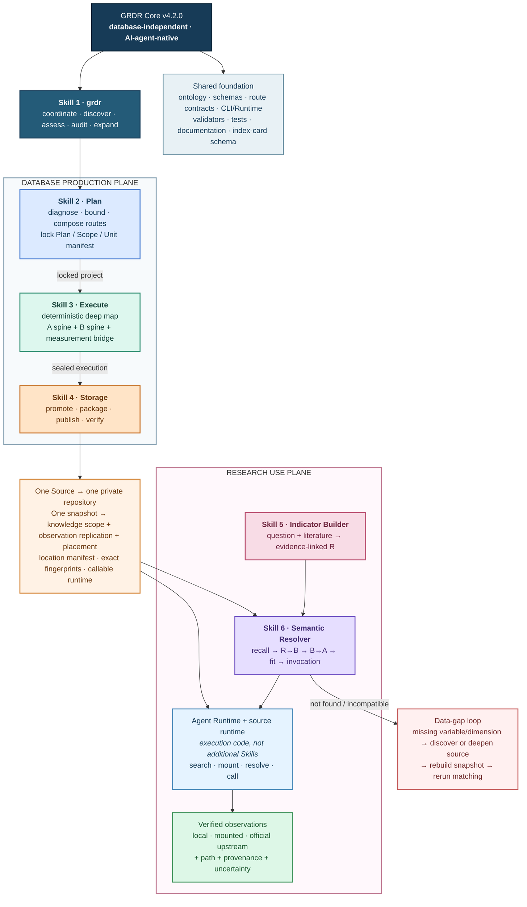
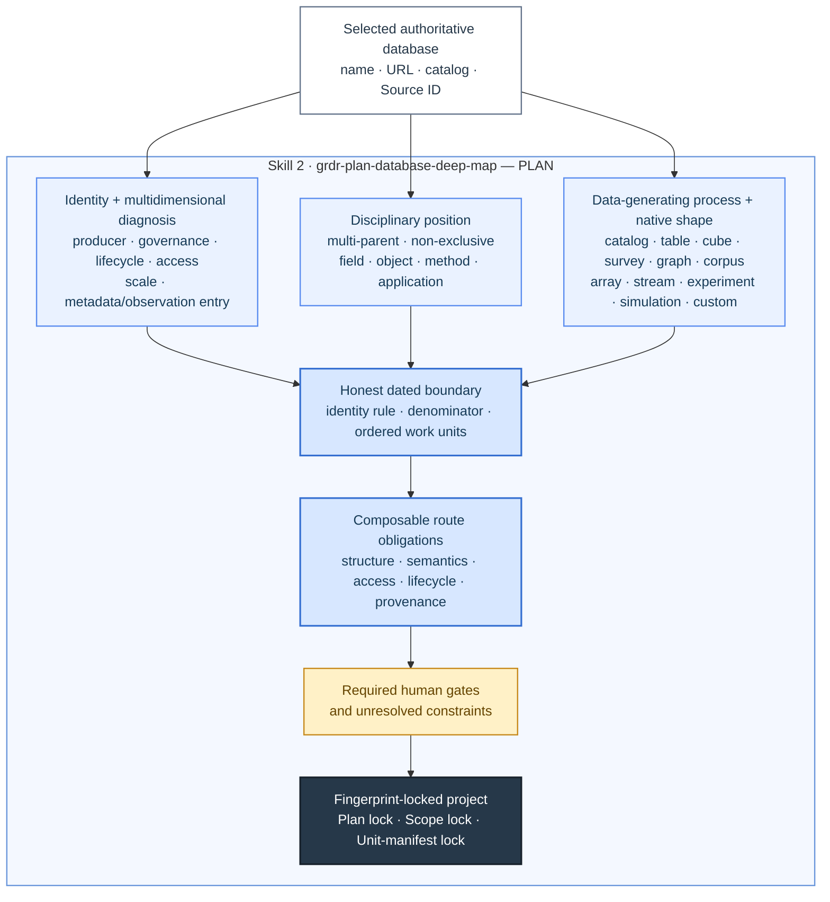
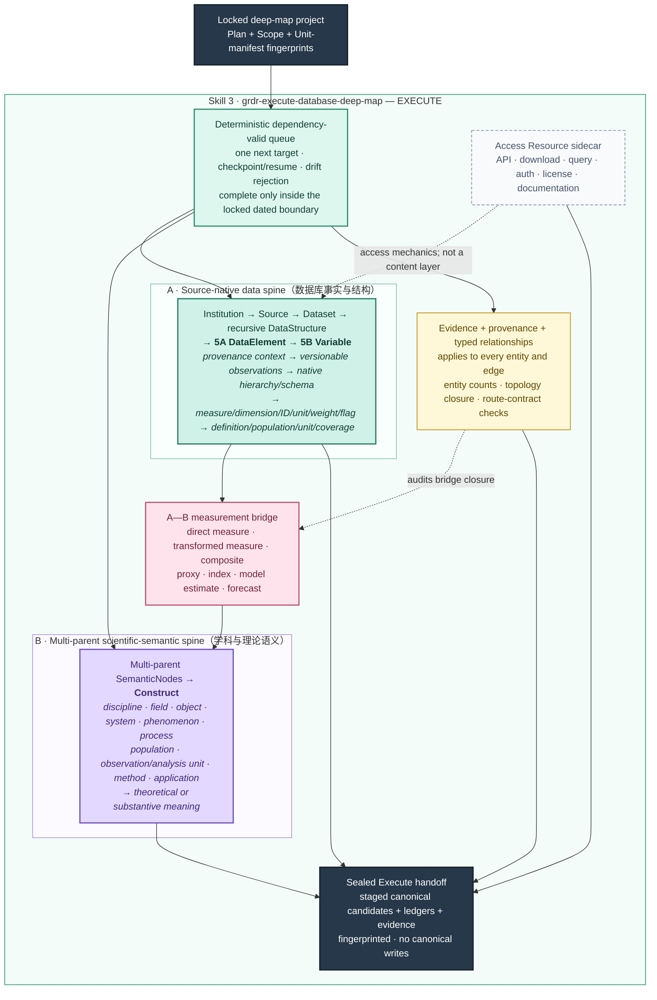
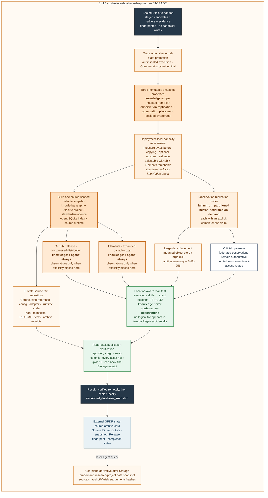
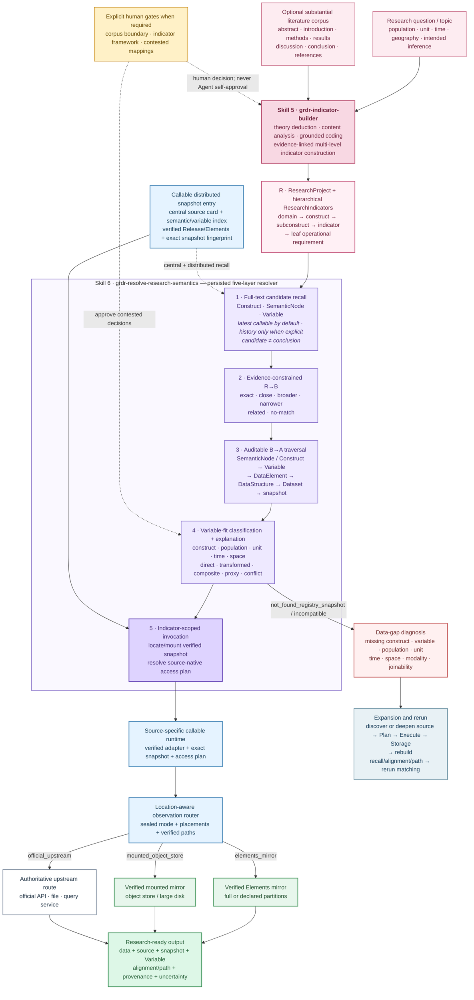

# GRDR Core

GRDR Core is the database-independent engine for the Global Research Data Registry: an AI-agent-native, all-discipline infrastructure for data-source registration, deep mapping, research matching, and distributed snapshot storage.

This repository contains no database snapshot, database-specific adapter, canonical source record, source-archive card, project state, or observation data. Mutable registry and project state lives under external `GRDR_STATE_ROOT`; every selected database is stored in its own private source repository.

## Three-step database factory

GRDR Core fixes the workflow as three independent, Agent-callable Skills:

1. `grdr-plan-database-deep-map` diagnoses an unknown database, defines its bounded work-unit universe, composes route obligations, and fingerprint-locks the Plan.
2. `grdr-execute-database-deep-map` follows the deterministic queue, reconstructs native structure and disciplinary semantics, builds the DataElement → Variable → Construct bridge, and seals the execution without canonical writes.
3. `grdr-store-database-deep-map` transactionally promotes sealed records, inherits the locked knowledge scope, selects full-mirror, partitioned-mirror, or federated observation handling, publishes the callable knowledge and Runtime artifacts, verifies every declared location, writes the central source card, and issues the final Storage receipt.

These three Skills are the database production plane. The independent GRDR Agent Runtime is the use plane: it searches central and distributed variable indexes, performs full manifest and SHA-256 verification before treating a snapshot as callable, resolves a variable to its source-native access plan, and passes the sealed observation-route context to the source-specific runtime. Storage packages and tests the runtime artifact; it does not own search, matching, or retrieval behavior.

## Research use plane

GRDR has six formal Skills in total. `grdr` is the coordinator; the three Skills above produce database snapshots; `grdr-indicator-builder` converts a research question and literature into evidence-linked leaf indicators; and `grdr-resolve-research-semantics` persists the missing R→B entry bridge, traverses the stored B→A graph, evaluates variable fit, explains every selected route, and invokes the verified local, mounted, or official observation route through the source runtime. Agent Runtime and source-specific runtimes are versioned execution code rather than additional Skills.

## Core architecture

The complete architecture is shown in three linked views so that every element remains readable at normal GitHub width: the system overview, the database production plane, and the research use plane. The production view is divided into Plan, Execute, and Storage panels without changing the single three-step workflow.

### 1. End-to-end system overview



### 2. Database production plane: Plan → Execute → Storage

#### 2A. Plan — 诊断、定界、路线组合与三重锁定



#### 2B. Execute — 两根主干、一座桥梁和确定性执行



#### 2C. Storage — 三属性快照、三种观测模式、位置清单和最终回执



#### 2D. 不同规模数据库的统一处理规则

数据库规模只影响**原始观测数据的复制方式与物理存放位置**，不得降低知识解析深度。无论数据库通常被称为小型、中型还是大型，GRDR 都必须在 Plan 锁定、Execute 验证的知识范围内，完整保存数据库结构、变量语义、方法证据和 Agent 调用能力。这里的“完整”始终对应快照中明确声明的 `knowledge_scope`，不能把局部样本冒充整个上游数据库。

“小型／中型／大型”是当前部署容量策略根据字节数计算出的可调建议，不是数据库固有身份，也不改变三项核心快照属性。实际快照必须记录 Plan 继承的 `knowledge_scope`、Storage 选择的 `observation_replication`、可多选的 `observation_placement`，并附带 `capacity_assessment`，保存当时实际使用的阈值、测量字节数、估计依据、分类和决策。以后硬件升级只需调整外部参数，不需要修改 Skill。

当前默认参数如下。前两项可以在外部配置中调整；第三项是 GitHub 平台的单文件硬约束，不能通过 GRDR 参数突破。

| 参数 | 当前默认值 | 超过后的实际行为 | 是否可调 |
|---|---:|---|---|
| `github_release_observation_max_bytes` | 5 GiB | 不允许把该快照的观测数据配置到 GitHub Release；知识和 Agent 制品仍照常发布 | 是 |
| `elements_full_mirror_max_bytes` | 10 GiB | 不允许继续选择 Elements 完整镜像；改用分区镜像、联邦调用或具备容量的挂载存储 | 是 |
| `github_release_asset_max_bytes` | 严格低于 2 GiB／文件 | 任何知识、Agent 或观测 Release 文件超限都必须重新分包，不能发布 | 只能调低，不能超过平台上限 |

默认推荐分类为：不超过 GitHub 阈值是“小型”；超过 GitHub 阈值但不超过 Elements 完整镜像阈值是“中型”；超过 Elements 阈值是“大型”。分区或联邦快照如果没有可靠的上游总体量估计，则分类明确记为 `unknown`，不会用已经复制的局部数据量冒充整个数据库规模。

| 内容或能力 | 所有数据库的硬性规则 | 常见小型数据库 | 常见中型数据库 | 常见大型或持续更新数据库 |
|---|---|---|---|---|
| 机构、发布者与数据源身份 | 在锁定范围内完整保存，并保留官方来源和版本证据 | 完整保存 | 完整保存 | 完整保存 |
| 数据集目录与包含关系 | 完整保存 Dataset 及其父子、版本和派生关系 | 完整保存 | 完整保存 | 完整保存 |
| 数据库原生结构 | 完整保存表、目录、主题、立方体、序列、文件、字段等递归 `DataStructure` | 完整保存 | 完整保存 | 完整保存 |
| 5A 数据元素 | 完整保存指标、测度、维度、标识符、单位、权重、状态标记和派生元素 | 完整保存 | 完整保存 | 完整保存 |
| 5B 变量 | 完整保存定义、总体、观察单位、分析单位、时间、地理和适用范围 | 完整保存 | 完整保存 | 完整保存 |
| 学科语义与理论构念 | 完整保存多父节点 B 主干、Construct 和适用学科语境 | 完整保存 | 完整保存 | 完整保存 |
| A—B 映射桥梁 | 完整保存 DataElement → Variable → Construct 的可追溯关系 | 完整保存 | 完整保存 | 完整保存 |
| 方法、口径、质量与证据 | 完整保存方法说明、分类标准、修订、限制、来源和证据定位 | 完整保存 | 完整保存 | 完整保存 |
| 访问方式 | 作为 Resource 侧车保存 API、下载、查询器、许可和访问约束，不占用内容层级 | 完整保存 | 完整保存 | 完整保存 |
| Agent 知识制品 | 必须保存知识图谱、Agent SQLite 索引、变量访问计划和来源专属 Runtime | 完整保存 | 完整保存 | 完整保存 |
| 原始观测数据复制 | 只允许由观测策略决定；不得混入 `knowledge/` | 通常完整镜像 | 完整镜像或按年份、国家、主题等分区镜像 | 通常保留在官方上游，按需调用；条件允许时仍可镜像 |
| 未复制的原始观测数据 | 必须保留可验证的官方位置和可执行访问路径 | 通常没有 | 未镜像部分保留在官方上游 | 保留在官方上游 |
| 研究项目数据快照 | 按需把一次查询的参数、结果、来源快照、变量 ID 和哈希封存到研究项目 | 可选 | 推荐 | 推荐 |
| 完整性声明 | 必须明确知识边界、观测复制边界、文件或分区数量及其依据 | 完整范围声明 | 完整范围或声明分区集 | 知识完整、观测联邦调用声明 |

因此，大型数据库不是“少解析一部分”，而是**完整理解以后不重复搬走全部数值**；中型数据库也不必强制复制。如果某个中型数据库无法合理镜像，就使用联邦按需调用；如果某个大型数据库实际能够完整复制，也可以选择完整镜像。

##### 三种原始观测数据处理模式

| Storage 模式 | 适用判断 | 快照中的原始观测数据 | 允许的主要位置 | 强制完整性声明 | Agent 使用方式 | 完成前必须核验 |
|---|---|---|---|---|---|---|
| `full_mirror` 完整镜像 | 锁定范围内的全部观测文件能够复制和持续管理，且所选物理位置没有超过其配置阈值 | 声明范围内全部复制 | GitHub Release、Elements、挂载对象存储，可多选；GitHub 不是必选 | `complete_within_knowledge_scope` | Runtime 获得位置上下文并使用已核验的 Elements 或挂载镜像 | 权威文件分母、预期与实际文件数、实际字节数、逐文件 SHA-256、所选位置和容量策略 |
| `partitioned_mirror` 分区镜像 | 只复制明确且有研究价值的年份、国家、主题或其他分区 | 仅复制分区清单中声明的完整分区 | GitHub Release、Elements、挂载对象存储，可配研究项目缓存 | `complete_declared_partition_set` | Runtime 优先使用已核验的本地／挂载分区；范围外数据只有在登记了官方路径时才联邦调用 | Schema 有效的分区清单；每个分区的边界、名称、成员路径、大小、SHA-256；预期与实际分区数和文件数完全一致 |
| `federated_on_demand` 联邦按需调用 | 整体复制不合理、数据持续更新，或官方查询服务更适合调用 | 规范快照中不复制原始观测文件 | `official_upstream`，可声明未来允许 `research_project_cache`；不得伪装为本地镜像 | `knowledge_complete_observations_federated` | Runtime 从已核验的官方服务按变量和参数获取；查询发生后才可封存研究项目快照 | **Storage 完成时**只核验官方地址、来源专属 Runtime 和全部变量可解析；查询结果和项目快照哈希属于以后实际调用的验收，不是 Storage 完成条件 |

选择顺序是：先锁定并完成同等深度的知识解析，再根据观测数据的实际体量、分区性、更新频率、官方接口和可维护性选择模式。不得先用“数据库很大”作为理由缩减知识范围，也不得为了宣称完整而把未复制的数据写成已经镜像。

##### 知识、观测与备份的关系

`knowledge/` 与 `observations/` 在逻辑上必须彻底分离，但通过 Source ID、Snapshot ID、Dataset／Variable ID、位置清单和 SHA-256 精确连接。Agent 的标准调用顺序是：检索知识索引 → 解析变量和访问计划 → 定位并核验观测资产 → 获取数值 → 必要时封存研究项目数据快照。

- 原始观测文件不得同时混入知识包和观测包；跨逻辑包出现相同内容哈希时，Storage 必须失败。
- 同一观测资产可以在 GitHub Release、Elements 或对象存储中保留经过核验的物理镜像。多份镜像提高在线可得性、本地速度和灾难恢复能力，但不会改变数据本身的统计准确性。
- `location-aware manifest` 必须记录每个逻辑文件的实际位置和哈希，使 Agent 能确认不同位置对应同一快照，而不是两个互相冲突的版本。
- 研究项目缓存是带查询范围和来源证据的派生快照，不得冒充数据库的规范观测镜像。

### 3. Research use plane: R → B → A → verified observation route



Resources such as APIs, downloads, authentication, and licenses are access sidecars rather than content levels.

## Repository boundary

GRDR Core keeps only:

- shared Skills, schemas, route contracts, programs, and documentation;
- empty canonical Registry filename templates and the source-archive card schema;
- generic, synthetic tests that do not identify a real database.

Each deeply processed database keeps its own configuration, adapters, Plan, Execute package, full knowledge snapshot, Agent index, source runtime, observation-location manifest, and Release history outside this repository. Full and partitioned mirrors keep the declared observation bytes only at their selected locations; federated snapshots keep official routes and create query-scoped research-project data snapshots on demand. Source repositories reference a Core version; they never copy the Core.

## Central source index

Core always keeps an empty index template. Completed source repositories add validated central cards only to external `GRDR_STATE_ROOT/registry/source_archives.jsonl` through Storage.

<!-- GRDR_SOURCE_CATALOG_START -->
当前注册表共收录 **0** 个数据库/数据平台。每个数据库均有独立六层详情页；“待验证候选”仅表示已经登记，不表示其覆盖与使用条件已经核验。

| 数据库 | 发布/维护机构 | 主要领域 | 拆解范围 | 拆解阶段 | 严格完成度 | 验证状态 | 六层详情 |
|---|---|---|---|---|---:|---|---|

完整的人机双读索引见 [GRDR数据库目录](catalog/README.md)。
<!-- GRDR_SOURCE_CATALOG_END -->

## Commands

```bash
python3 -m venv .venv
.venv/bin/python -m pip install -r requirements-validation.txt
python3 scripts/configure_core.py

# Persist an external Elements root once for all Agent Runtime commands.
python3 scripts/configure_core.py --elements-root /absolute/path/to/GRDR

# Optional deployment policy; change these values later as storage hardware changes.
python3 scripts/configure_core.py \
  --github-observation-max-gib 5 \
  --elements-full-mirror-max-gib 10

# Optional: choose another external mutable-state location.
export GRDR_STATE_ROOT=/absolute/path/outside/grdr-core

.venv/bin/python scripts/grdr.py list-database-route-modules
.venv/bin/python scripts/grdr.py plan-database-deep-map <intake.json> --output <plan.json>
.venv/bin/python scripts/grdr.py start-database-deep-map <spec.json>
.venv/bin/python scripts/grdr.py database-deep-map-status <project>
.venv/bin/python scripts/grdr.py resume-database-deep-map <project>
.venv/bin/python scripts/grdr.py audit-database-deep-map-execution <project>
.venv/bin/python scripts/grdr.py prepare-database-deep-map-storage <project>
.venv/bin/python scripts/grdr.py prepare-database-storage <project> <storage-spec.json>
.venv/bin/python scripts/grdr.py publish-database-storage <project>
.venv/bin/python scripts/grdr.py database-storage-status <project>
.venv/bin/python scripts/grdr.py source-snapshot-status --source-id <source-id> --verify
.venv/bin/python scripts/grdr.py prepare-semantic-candidates <research-project> --snapshot-policy latest_callable
.venv/bin/python scripts/grdr.py prepare-semantic-candidates <research-project> --snapshot-policy history  # explicit longitudinal use only
.venv/bin/python scripts/grdr.py align-research-indicators <research-project> <decisions.jsonl>
.venv/bin/python scripts/grdr.py traverse-semantic-paths <research-project>
.venv/bin/python scripts/grdr.py match-indicators <research-project>
.venv/bin/python scripts/grdr.py explain-indicator-match <research-project> <indicator-id>
.venv/bin/python scripts/grdr.py fetch-indicator-data <research-project> <indicator-id> --dry-run
.venv/bin/python scripts/grdr.py fetch-indicator-data <research-project> <indicator-id> --seal-data-snapshot
.venv/bin/python scripts/grdr.py search-variables --construct <construct>
.venv/bin/python scripts/grdr.py resolve-variable-access <variable-id>
.venv/bin/python scripts/grdr.py fetch-variable <variable-id> --dry-run
.venv/bin/python scripts/grdr.py fetch-variable <variable-id> --research-project-dir <research-project>
```

See [the database factory workflow](docs/DATABASE_DEEP_MAP_WORKFLOW.md) and [the North Star](docs/NORTH_STAR.md).

## Validation

```bash
.venv/bin/python scripts/validate_registry.py
.venv/bin/python scripts/build_catalog.py --check
.venv/bin/python scripts/check_release.py
.venv/bin/python -m unittest discover -s tests -v
```

Version `4.2.0` closes the scalable-Storage and Runtime trust boundary: deployment-local capacity thresholds are adjustable and sealed into each snapshot decision; partition manifests must exactly match their copied members; every normal Runtime operation fully verifies the local manifest-bound inventory; mirror, mounted, and upstream routes are explicit; and a snapshot cannot become complete until its final Storage receipt has been uploaded to GitHub and verified by read-back. Knowledge scope remains locked to Plan, and raw observations remain forbidden from the knowledge package.
