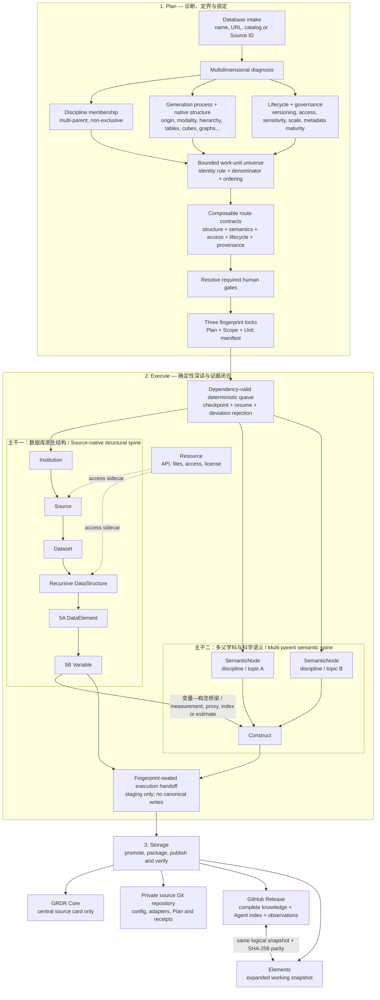

# GRDR Core

GRDR Core is the database-independent engine for the Global Research Data Registry: an AI-agent-native, all-discipline infrastructure for data-source registration, deep mapping, research matching, and distributed snapshot storage.

This repository contains no database snapshot, database-specific adapter, canonical source record, or observation data. Every selected database is processed in a separate project and stored in its own private source repository.

## Three-step database factory

GRDR Core fixes the workflow as three independent, Agent-callable Skills:

1. `grdr-plan-database-deep-map` diagnoses an unknown database, defines its bounded work-unit universe, composes route obligations, and fingerprint-locks the Plan.
2. `grdr-execute-database-deep-map` follows the deterministic queue, reconstructs native structure and disciplinary semantics, builds the DataElement → Variable → Construct bridge, and seals the execution without canonical writes.
3. `grdr-store-database-deep-map` transactionally promotes sealed records, creates the source-specific private repository, publishes one complete Release per snapshot, materializes the matching Elements copy, verifies SHA-256 parity, writes the central source card, and issues the final Storage receipt.

## Core architecture: two spines and one bridge



Resources such as APIs, downloads, authentication, and licenses are access sidecars rather than content levels.

## Repository boundary

GRDR Core keeps only:

- shared Skills, schemas, route contracts, programs, and documentation;
- empty canonical registry templates and the central source-archive index format;
- generic, synthetic tests that do not identify a real database.

Each deeply processed database keeps its own configuration, adapters, Plan, Execute package, full knowledge snapshot, Agent index, captured observations, Release history, and expanded Elements copy outside this repository. Source repositories reference a Core version; they never copy the Core.

## Central source index

The isolated milestone starts with an empty central index. Completed source repositories add only validated central cards through Storage.

<!-- GRDR_SOURCE_CATALOG_START -->
当前注册表共收录 **0** 个数据库/数据平台。每个数据库均有独立六层详情页；“待验证候选”仅表示已经登记，不表示其覆盖与使用条件已经核验。

| 数据库 | 发布/维护机构 | 主要领域 | 拆解范围 | 拆解阶段 | 严格完成度 | 验证状态 | 六层详情 |
|---|---|---|---|---|---:|---|---|

完整的人机双读索引见 [GRDR数据库目录](catalog/README.md)。
<!-- GRDR_SOURCE_CATALOG_END -->

## Commands

```bash
python3 -m venv .venv
.venv/bin/python -m pip install -r requirements-validation.txt

.venv/bin/python scripts/grdr.py list-database-route-modules
.venv/bin/python scripts/grdr.py plan-database-deep-map <intake.json> --output <plan.json>
.venv/bin/python scripts/grdr.py start-database-deep-map <spec.json>
.venv/bin/python scripts/grdr.py database-deep-map-status <project>
.venv/bin/python scripts/grdr.py resume-database-deep-map <project>
.venv/bin/python scripts/grdr.py audit-database-deep-map-execution <project>
.venv/bin/python scripts/grdr.py prepare-database-deep-map-storage <project>
.venv/bin/python scripts/grdr.py prepare-database-storage <project> <storage-spec.json>
.venv/bin/python scripts/grdr.py publish-database-storage <project>
.venv/bin/python scripts/grdr.py database-storage-status <project>
```

See [the database factory workflow](docs/DATABASE_DEEP_MAP_WORKFLOW.md) and [the North Star](docs/NORTH_STAR.md).

## Validation

```bash
.venv/bin/python scripts/validate_registry.py
.venv/bin/python scripts/build_catalog.py --check
.venv/bin/python scripts/check_release.py
.venv/bin/python -m unittest discover -s tests -v
```

Version `3.2.2` is the isolated GRDR Core milestone with distributed source-archive indexing. The Plan → Execute → Storage contract remains unchanged.
