# GRDR Core Version Audit Archive

本仓库是 GRDR 的软件工程审计档案，不是运行时 Core、数据库知识仓库或原始观测数据镜像。

它完整保存了 GRDR 从最早可核验的 `v0.1.0` 原型，到当前稳定 Core `v4.5.2` 的 Git 对象、版本谱系、审计标签、GitHub 归档 Release、文件树指纹、来源映射和恢复方法。这是 GRDR 第一次从零开发成功的 AI Agent 项目的永久工程档案，也是以后其他项目可以复用的版本审计范本。

## 最终审计结论

- 已找到并保存所有能够从原始 Git 历史、`VERSION`、`CHANGELOG.md` 和独立 Core 仓库相互印证的 GRDR 版本。
- 共保存 **36 个审计节点**：8 个 `1.0` 之前的演进节点、21 个 `v1.0.0–v4.5.2` 正式版本、1 个 `v4.0.0` 候选版本、3 个历史/等价变体和 3 个发布后纯文档快照。
- 共有 **29 个 canonical 版本节点**；正式发布序列从 `v1.0.0` 到 `v4.5.2` 共21个版本。
- `v4.0.0` 只发现了内容完整且可核验的 candidate，没有发现其正式 Release，因此本仓库保留候选树，但绝不把它冒充正式发布。
- 所有36个审计节点现在都有独立的 GitHub **审计归档 Release**，可以直接下载对应的源码归档；每个 Release 都绑定不可变审计标签、精确 commit 和 Git tree。
- 当前可运行产品仍是独立仓库 [`yangyuezh/grdr-core`](https://github.com/yangyuezh/grdr-core) 的 `v4.5.2`。本仓库只负责历史、审计和恢复。

没有 `v0.7.0–v0.9.x`、`v1.3.x` 或 `v2.1.x` 等标签，并不代表档案缺失：原始项目没有创建这些版本号。语义化版本号不要求连续递增每一个小版本。

## “所有版本都有 Release”是什么意思

这里必须区分两种事实：

1. **原始历史 Release**：版本开发当时就在原仓库创建的 GitHub Release。早期开发并没有为每个版本都执行这一步。
2. **审计归档 Release**：本仓库根据仍然存在的精确 Git 对象补建的恢复制品。它忠实记录原版本，却不会声称该 Release 在历史日期就已经存在。

因此，当前答案是：

- 在原始仓库层面，并非所有版本当时都有 GitHub Release；
- 在本审计仓库层面，所有已核验版本和重要历史节点现在都已经有独立 Release；
- 正式版、候选版、历史变体和发布后文档快照分别标注，不会混淆。

Git tag 才是锁定历史代码的核心证据；GitHub Release 是建立在 tag 之上的下载和说明界面。两者同时保留，才能兼顾不可变审计与人工使用。

## 为什么早期版本与 UNdata 深度绑定

GRDR 最初不是先在真空中写出完整平台，再选择一个数据库测试。它是在 UNdata 的真实复杂性中逐步发现需求、建立规则和完成工程化的：

- `v0.1.0–v0.4.0` 先建立注册表、六层目录、数据库拆解和研究指标构建能力；
- `v0.5.0–v3.1.0` 以 UNdata 的36个 datamart 为主验证对象，把“指导性 Skill”逐步变成可恢复、可审计、不会跑偏的执行工厂；
- `v3.1.0` 首次真正完成 UNdata 的 Plan → Execute → Archive 闭环；
- `v3.2.0` 把已经验证过的通用能力从 UNdata 仓库中剥离，形成数据库无关的独立 GRDR Core；
- `v4.x` 再解决不可变 Core、可移植性、不同体量数据库、在线调用、缓存、性能和跨数据库全局路由。

所以，UNdata 与早期代码共处一条 Git 谱系是开发事实，不是审计错误。正确做法不是删除这段关系，而是：

- 在审计仓库中原样保留早期一体化产品形态；
- 从 `v3.2.0` 起明确标记独立 Core 产品形态；
- 不把 UNdata 的数据库记录或观测数据误认为 GRDR Core 的组成部分；
- 不把后来的架构边界倒写进早期版本。

## 完整演进总图

```mermaid
flowchart LR
    A["0.1<br/>项目定义与注册表"] --> B["0.2-0.3<br/>人机目录与六层拆解"]
    B --> C["0.4-0.6<br/>指标构建与研究闭环"]
    C --> D["1.x<br/>稳定数据结构与持久化深度读取"]
    D --> E["2.0<br/>锁定执行契约、双主干与桥梁"]
    E --> F["3.0<br/>Plan / Execute / Archive 三步工厂"]
    F --> G["3.1<br/>UNdata 首次完整生产闭环"]
    G --> H["3.2<br/>独立、数据库无关 Core"]
    H --> I["3.3-3.4<br/>Agent Runtime 与 R→B→A"]
    I --> J["4.0<br/>不可变 Core、外部状态与可移植性"]
    J --> K["4.1-4.2<br/>可扩展 Storage 与严格完整性"]
    K --> L["4.3-4.4<br/>通用在线调用与可选本地缓存"]
    L --> M["4.5.0<br/>全局索引与跨数据库路由"]
    M --> N["4.5.1<br/>Core→Source Runtime<br/>参数化调用验收门"]
    N --> O["4.5.2<br/>高基数深度映射<br/>线性审计与有界输出"]
```



## 第一阶段：从构想到可研究的原型（v0.1.0–v0.6.0）

| 版本 | 本版本建立的核心能力 | 下一版本带来的改变和提升 | UNdata／实测关系 |
|---|---|---|---|
| `v0.1.0` | 建立项目章程、North Star、本体、评估框架、Agent 协议、基础 Schema、19个数据源初始注册表和第一个 WDI 变量链。 | `v0.1.1` 统一产品与 Skill 身份，消除旧的“全局数据仓库”命名。 | UNdata 只是首批被核验的数据入口之一，主示例仍是 WDI。 |
| `v0.1.1` | 全面统一为 `GRDR`／`$grdr`，把物理数据仓库降为可选存储方式，而不是项目定义。 | `v0.2.0` 增加人和 Agent 都能阅读的数据库目录。 | 尚未深读 UNdata，先固定项目身份。 |
| `v0.2.0` | 增加根目录清单、每库独立页面、机构→数据源→数据集→资源→变量→构念六层展示和目录漂移检查。 | `v0.3.0` 把六层说明升级为专门的数据库拆解 Skill 和深度审计。 | UNdata 开始能够按统一目录规则被登记和展示。 |
| `v0.3.0` | 建立 `grdr-source-profiler`，记录拆解范围、层级声明、枚举边界、阻断项和深度审计命令。 | `v0.3.1` 修复 Skill 在任意 checkout 中寻找 GRDR 根路径的问题。 | 为后续深读 UNdata 建立了第一套规范，但仍偏指导性。 |
| `v0.3.1` | 修复 profiler 路径发现，使 Skill 能在 GitHub Actions 和不同目录运行。 | `v0.4.0` 从“拆数据库”扩展到“由研究问题和文献构建指标”。 | 解决工具只能在本机特定目录运行的早期问题。 |
| `v0.4.0` | 建立文献约束的 `grdr-indicator-builder`、多层指标体系、证据单元、变量映射和人工审核门。 | `v0.5.0` 首次把数据库内部结构真正展开到 DataElement 和变量层。 | 数据库侧与研究问题侧开始形成两条可连接的链。 |
| `v0.5.0` | 完成首个目录级 UNdata profile：36个 datamart、6个 glossary、SDMX DataElement、5A/5B、变量与构念、通用 SDMX 检查器。 | `v0.6.0` 把静态变量匹配升级为可保存、可补缺、可重跑的研究项目闭环。 | UNdata 成为第一个系统性深读对象；明确“目录完整”不等于“变量和观测完整”。 |
| `v0.6.0` | 增加7个研究项目生命周期命令、工作流状态、数据缺口、重匹配和首个真实五指标研究测试。 | `v1.0.0` 重构六层模型，正式引入 DataStructure，并把 Resource 移出内容层级。 | 首次用 UNdata 测试人口、能源、收入、产业结构和 CO₂；3项命中、2项如实标记缺口。 |

## 第二阶段：把“深读数据库”工程化（v1.0.0–v2.0.0）

| 版本 | 本版本建立的核心能力 | 下一版本带来的改变和提升 | UNdata／实测关系 |
|---|---|---|---|
| `v1.0.0` | 稳定 Institution → Source → Dataset → DataStructure → 5A DataElement/5B Variable → Construct；Resource 成为访问侧车；形成 `grdr-deep-map-database`。 | `v1.1.0` 把仍然偏说明性的 Skill 变成持久化、可恢复的状态机。 | UNdata Energy、GHG 与 WDI 用于证明新层级能够表达真实数据库结构。 |
| `v1.1.0` | 建立 `deep_map_projects`、有序工作单元、阶段账本、阻断项、确定性 `next_target` 和7个数据库生命周期操作。 | `v1.2.0` 增加未知数据库预诊断和开放世界路线组合，避免只适应 SDMX。 | UNdata 被迁移为36个工作单元、216个阶段的首个真实持久化项目；进度不再凭感觉报告。 |
| `v1.2.0` | 建立29个可组合路线模块、70个强制 facets、`checks.jsonl`、人工门、动态/受限/多模态/未知结构的恢复规则。 | `v2.0.0` 从“阶段与检查完成”升级为锁定范围、双图主干和变量—构念桥梁的硬执行契约。 | 保持 UNdata 原有真实进度不变，同时扩展到617项路线检查，证明迁移不会虚增完成度。 |
| `v2.0.0` | 固定 Plan/范围/工作单元指纹、确定性队列、断点恢复、漂移拒绝、SemanticNode、数据结构主干、科学语义主干与 Variable→Construct 桥梁。 | `v3.0.0` 将单个深读 Skill 拆成职责隔离的 Plan、Execute、Archive 三步工厂。 | UNdata 成为727项检查和108个图产品的压力测试；工程保证与上游不可获得性被严格区分。 |

## 第三阶段：形成完整生产闭环并剥离 Core（v3.0.0–v3.4.0）

| 版本 | 本版本建立的核心能力 | 下一版本带来的改变和提升 | UNdata／实测关系 |
|---|---|---|---|
| `v3.0.0` | 拆出 Plan、Execute、Archive 三个独立 Skill；增加 schema-3 交接、候选暂存、原子晋升、冲突检测、归档包和不可变回执。 | `v3.1.0` 用一个真实数据库把三步工厂第一次完整跑通并封存。 | UNdata 项目被迁移但不篡改历史进度；Execute 在归档前不能写 canonical 状态。 |
| `v3.1.0` | 完成第一个生产级闭环：36/36 datamart、8,719层级节点、9,334变量、194 DataElement、43,000关系、62,013候选记录全部通过三步工厂。 | `v3.2.0` 把经 UNdata 验证的通用能力从一体化仓库中彻底剥离为干净 Core。 | 这是 UNdata 首次完整、指纹锁定的元数据深读；明确没有镜像观测行，也不夸大上游范围。 |
| `v3.2.0` | 在新谱系建立数据库无关 Core；固定 Plan、Execute、Storage；每个数据库独立仓库和 Release；Core 只保留空模板与通用能力。 | `v3.2.1` 修复外部磁盘和 macOS 元数据进入 Storage 的实际问题。 | UNdata 从“与 Core 同仓”变为“引用 Core 的独立来源仓库”；这是产品边界的决定性转折。 |
| `v3.2.1` | 排除 `.DS_Store`/AppleDouble，支持外部快照卷，并允许中央索引保存已完成来源卡片。 | `v3.2.2` 允许只凭分布式来源卡验证卡片，不再要求复制数据库 Source 记录回 Core。 | 使用外部 UNdata 快照暴露并验证 macOS 外盘问题。 |
| `v3.2.2` | 修复分布式 `source_archives.jsonl` 校验，保持 Core 无数据库内容。 | `v3.3.0` 增加独立 Agent Runtime 和 Source Runtime 1.0，使封存结果真正可被 Agent 调用。 | UNdata 卡片和数据库知识继续位于外部，Core 只索引和定位。 |
| `v3.3.0` | 建立分布式 Agent Runtime、统一变量搜索、Release 物化、变量解析、来源调用以及 `grdr-source-runtime/1.0`。 | `v3.4.0` 打通研究指标 R → 科学语义 B → 数据变量 A 的完整入口。 | 已封存的 UNdata 快照从“可存档”升级为“可检索、可解析、可调用”。 |
| `v3.4.0` | 增加第六个 Skill `grdr-resolve-research-semantics`，持久化 R→B 对齐、B→A 多跳路径、匹配解释、适配判断和指标级调用。 | `v4.0.0-candidate` 强制 Core 不可变、状态外置和六个 Skill 的位置无关运行。 | 用 UNdata 的可调用快照前向验证完整 R→B→A 路径。 |

## 第四阶段：不可变、可扩展、可跨数据库运行（v4.0.0–v4.5.2）

| 版本 | 本版本建立的核心能力 | 下一版本带来的改变和提升 | UNdata／实测关系 |
|---|---|---|---|
| `v4.0.0-candidate` | 候选版：Core 只读且数据库无关；全部 mutable state 外置到 `GRDR_STATE_ROOT`；六个 Skill 使用可移植 launcher；增加任意目录调用和 Storage 后 Core 仍干净的测试。 | `v4.0.1` 修复多快照语义召回默认混入历史记录的问题，并形成首个正式4.x交付。 | 候选 Core 仍来自 UNdata 实验仓库中的 `core-candidate/`，审计仓库保存了字节等价的独立根目录树。 |
| `v4.0.1` | 普通研究默认只召回最新可调用快照；历史研究显式使用 `--snapshot-policy history`；完成隔离、可移植和调用链复验。 | `v4.0.2` 修复新 Dataset 在 Execute 中产生 ID 时可能破坏 Plan 工作单元指纹的问题。 | 解决 UNdata 多代快照同时被召回造成的结果噪声。 |
| `v4.0.2` | 保持 Plan-time 工作单元清单不可变，同时允许 Execute 为新 Dataset 建立 canonical ID。 | `v4.1.0` 把知识解析、观测复制程度和存储位置拆成独立属性，适应不同体量数据库。 | 修复由第二个数据库 UNESCO UIS 暴露的问题，并对 UNdata 做回归验证。 |
| `v4.1.0` | 增加 `full_mirror`、`partitioned_mirror`、`federated_on_demand`，原始观测与知识包彻底分离，支持研究项目数据快照。 | `v4.1.1` 增加过期语义路径检测和本地快照位置发现，阻止旧映射误调用。 | UNdata 与 UNESCO UIS 的存储体量差异推动 Storage 从单一复制规则升级。 |
| `v4.1.1` | 检测指向旧快照的 ResearchIndicator 路径并要求重跑；普通变量检索默认 current-only；外部快照位置可持久化。 | `v4.2.0` 增加容量阈值、严格分区清单、Release 回执回读和完整 SHA-256 校验。 | 防止研究项目继续调用已被新版 UNdata 快照替代的变量路径。 |
| `v4.2.0` | 引入可调 GitHub/本地容量参数、每文件分区清单、位置上下文、远端回执验证和完整运行时校验缓存失效机制。 | `v4.3.0` 把在线调用从一种存储模式提升为所有数据库都必须建设的独立能力。 | 对 UNdata 和 UNESCO UIS 的真实存储与调用边界进行系统加固。 |
| `v4.3.0` | 三条轴正式分离：知识范围、在线访问、观测复制；Source Runtime 2.0；`latest/reproducible/offline` 路由策略；复制模式改为完整、分区或不镜像。 | `v4.4.0` 将 GitHub Release 固定为发布真源，本地展开副本降为可选缓存，并优化哈希与在线重试。 | 重新在线读取 UNdata，证明“大库可以完整吃透知识而不整体搬走观测值”。 |
| `v4.4.0` | GitHub 来源仓库与 Release 成为 canonical；取消新项目对 Elements 的硬依赖；本地快照仅是可重建缓存；增加持久校验回执、路线预筛和指数退避。 | `v4.5.0` 增加跨数据库全局索引与路由，避免数据库增多后逐库扫描。 | 解决 UNdata/UNESCO UIS 每次启动重新哈希、错误路线先尝试和官方接口偶发超时等实测问题。 |
| `v4.5.0` | 建立外部可重建的 Global Index & Routing Layer、SQLite/FTS、精确实体定位、Variable→Construct/route 索引、两阶段召回和增量刷新。 | `v4.5.1` 修复来源Runtime可通过自检却不兼容Core公共参数的验收缺口。 | 首次具备在 UNdata、UNESCO UIS 及未来大量独立数据库之间快速发现和路由的可扩展入口。 |
| `v4.5.1` | 新增Core驱动的参数化调用验收门：真实Variable必须以国家／时期参数完成`latest`取数；存在离线路线时还必须完成`offline`取数；行数、路线、产物和输出指纹封入`invocation_acceptance_audit.json`。 | `v4.5.2` 解决数十万记录与关系下的二次复杂度和超大命令输出。 | 在World Development Indicators最终r2快照上，以美国总人口、2023–2024完成在线与离线双路线实测，两条路线各返回2行；同时保留旧版不可变快照的兼容审计。 |
| `v4.5.2` | 将候选记录重复检测、图主干端点与连通性校验改为线性复杂度；大型暂存批次只返回确定性ID样本与全量指纹，不再输出几十万ID。 | 当前稳定终点；未来版本必须按本仓库的归档协议继续追加，不改写既有节点。 | 由OECD Data Explorer的331,002条候选记录、250,912条关系和完整Execute审计暴露并验证；六层、三条主干和31项形态检查均无错误、无警告。 |

## 同版本号的历史节点

这些节点不是新增的正式版本号，但对解释产品边界和提交谱系非常重要，因此同样拥有审计标签和归档 Release。

| 审计节点 | 类型 | 保留原因 |
|---|---|---|
| `v3.2.0-monolith` | 历史产品形态变体 | 保留独立 Core 出现前的一体化 `v3.2.0`，用于解释同版本号下的架构分叉。 |
| `v3.4.0-monolith` | 历史产品形态变体 | 保存研究语义解析能力在一体化谱系中的原始提交。 |
| `v3.4.0-clean-docs` | 发布后文档快照 | 保存 `v3.4.0` 标签之后补充的最终架构图和说明，不移动正式 tag。 |
| `v4.0.0-candidate` | 候选版本 | 保存 UNdata 实验仓库 `core-candidate/` 的字节等价树；没有伪造正式 Release。 |
| `v4.0.1-archive-docs` | 发布后文档快照 | 保存独立 `v4.0.1` 归档仓库补充的定位与边界说明。 |
| `v4.1.1-transitional-root` | 等价树变体 | 文件树与 canonical `v4.1.1` 相同，但根提交谱系不同，保留供 commit 级审计。 |
| `v4.5.0-current-docs` | 发布后文档快照 | 保存 `v4.5.0` tag 后对“当前稳定 Core”所作的纯文档确认。 |

## 仓库结构

```text
README.md                     完整产品历史、逐版本变化和审计结论
ARCHIVE_VERSION               审计仓库自身的版本，不等于 GRDR Core 版本
audit/version-map.jsonl       人工核定的版本—提交—来源映射
audit/version-ledger.jsonl    由 Git 对象生成的机器审计账本
audit/version-ledger.csv      便于人工查看的同源表格
audit/archive-manifest.json   覆盖范围、版本计数与文件指纹
audit/SHA256SUMS              审计控制文件校验值
scripts/audit_archive.py      本地 Git 对象、标签、tree 和 VERSION 核验
scripts/audit_remote_releases.py  GitHub 逐版本 Release 覆盖核验
docs/ARCHIVE_POLICY.md        以后所有项目可以复用的工程化归档规则
docs/RESTORE.md               提取、比较与恢复任一版本
```

软件本体不在 `main` 中重复复制。每个版本由 `audit/...` tag 锁定精确提交；原始父子关系由 `lineage/...` 分支保存；GitHub Release 提供按版本下载入口。这样同时保留文件内容、提交身份、作者时间、父子谱系和面向人的版本说明。

## 核验

本地对象和账本核验：

```bash
python3 scripts/audit_archive.py
```

GitHub Release 覆盖核验：

```bash
python3 scripts/audit_remote_releases.py
```

核验器检查：

1. 每个账本 tag 是否仍指向规定 commit；
2. commit 绑定的 Git tree 是否与账本一致；
3. 根目录 `VERSION` 是否与档案声明一致；
4. `v4.0.0 candidate` 是否与 UNdata 原始 `core-candidate/` 子树字节等价；
5. canonical `v4.1.1` 与过渡根提交是否保持相同文件树；
6. 账本、清单和 SHA-256 文件是否可重复生成；
7. 每个审计标签是否都有非草稿 GitHub Release，且正式版和非正式节点的 prerelease 分类是否正确。

## 以后新增版本的固定归档流程

每次 GRDR Core 发布新版本后，审计仓库必须执行以下流程：

1. 在原 Core 仓库完成测试、版本号、CHANGELOG、commit、tag 和正式 Release；
2. 把原始谱系 fetch 到本仓库，不复制或重写提交；
3. 在 `audit/version-map.jsonl` 登记版本、来源、状态和精确 commit；
4. 创建新的不可移动 `audit/...` 标签；
5. 在 README 追加“本版能力、下一版提升、真实数据库验证关系”；
6. 重新生成机器账本、CSV、manifest 和 SHA-256；
7. 创建清楚标注历史状态的审计归档 Release；
8. 运行本地核验、远端 Release 核验、GitHub Actions 和全新克隆恢复测试；
9. 为审计仓库自身发布新的 `archive-vX.Y.Z` 制品。

任何情况下都不得移动旧 tag、重写旧提交、把 candidate 伪装为正式版，或因为后来架构更好就修改早期历史。

## 边界

- 本仓库保存 GRDR 软件，不复制 UNdata、UNESCO UIS 或其他数据库的观测数据。
- 历史一体化版本中的真实数据库记录属于当时产品形态，不代表当前 Core 允许数据库内容进入代码树。
- 当前运行、数据库生产和研究调用继续使用 GRDR Core 与各数据库独立仓库；本仓库不参与运行时路由。
- 审计归档 Release 的发布日期是补建日期；版本真实时间、commit 时间和来源均以机器账本为准。
