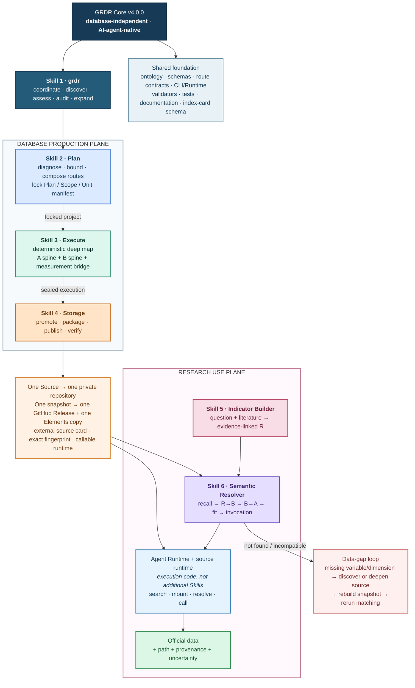
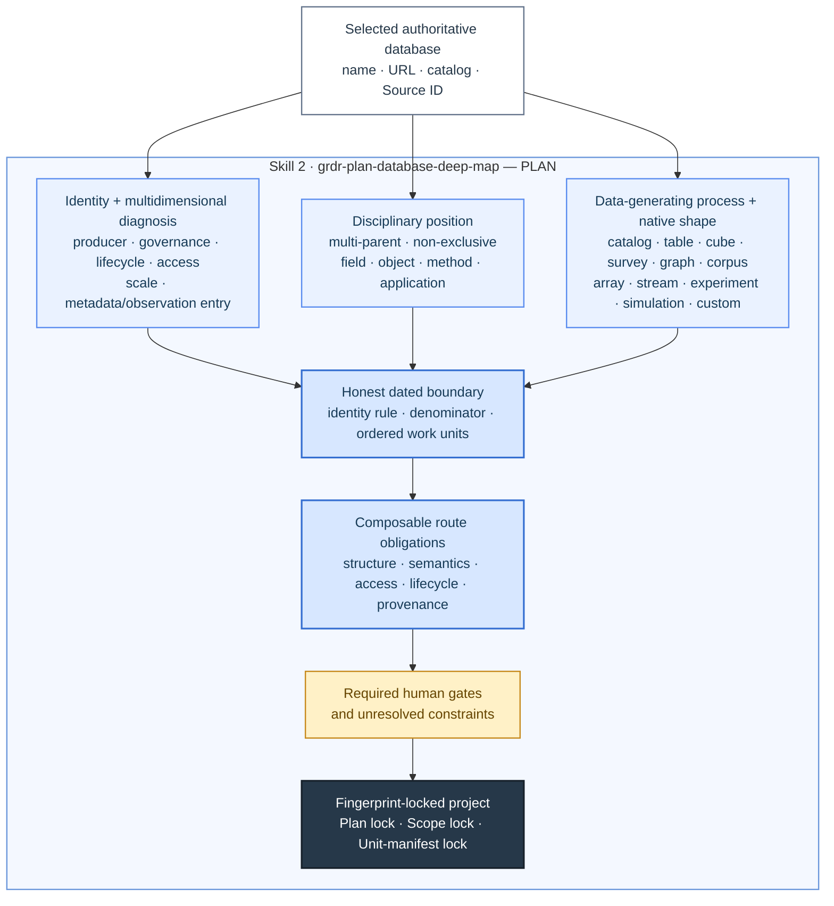
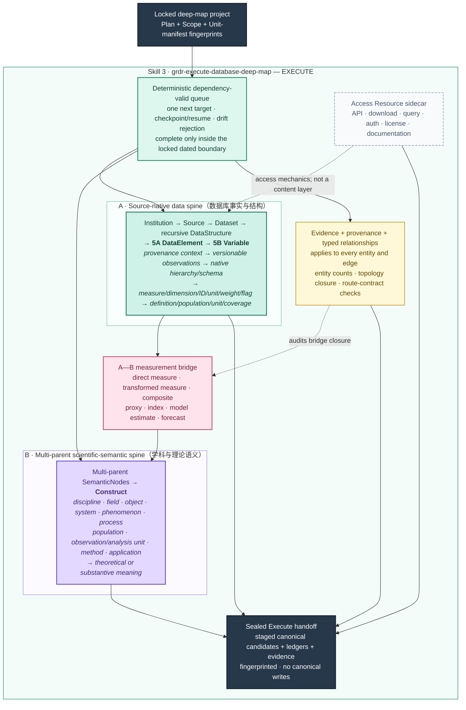
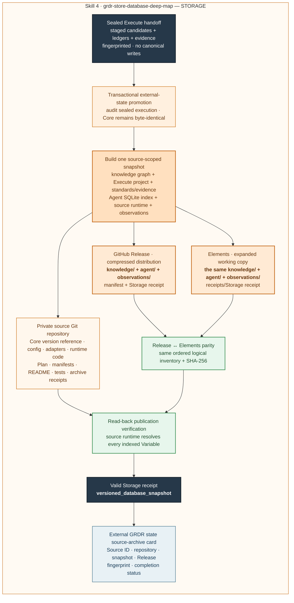
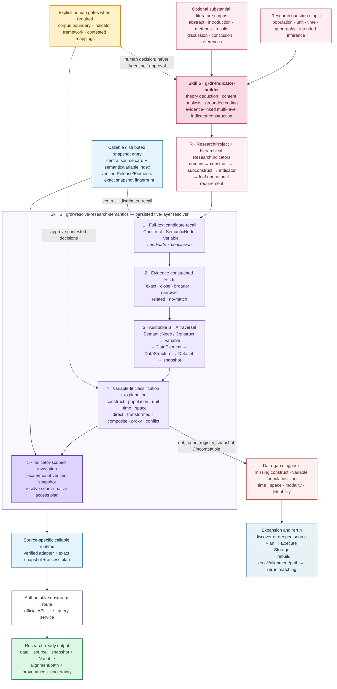

# GRDR Core

GRDR Core is the database-independent engine for the Global Research Data Registry: an AI-agent-native, all-discipline infrastructure for data-source registration, deep mapping, research matching, and distributed snapshot storage.

This repository contains no database snapshot, database-specific adapter, canonical source record, source-archive card, project state, or observation data. Mutable registry and project state lives under external `GRDR_STATE_ROOT`; every selected database is stored in its own private source repository.

## Three-step database factory

GRDR Core fixes the workflow as three independent, Agent-callable Skills:

1. `grdr-plan-database-deep-map` diagnoses an unknown database, defines its bounded work-unit universe, composes route obligations, and fingerprint-locks the Plan.
2. `grdr-execute-database-deep-map` follows the deterministic queue, reconstructs native structure and disciplinary semantics, builds the DataElement → Variable → Construct bridge, and seals the execution without canonical writes.
3. `grdr-store-database-deep-map` transactionally promotes sealed records, creates the source-specific private repository, publishes one complete callable Release per snapshot, materializes the matching Elements copy, verifies SHA-256 parity and the source runtime, writes the central source card, and issues the final Storage receipt.

These three Skills are the database production plane. The independent GRDR Agent Runtime is the use plane: it searches central and distributed variable indexes, mounts a verified snapshot, resolves a variable to its source-native access plan, and invokes the source-specific runtime. Storage packages and tests the runtime artifact; it does not own search, matching, or retrieval behavior.

## Research use plane

GRDR has six formal Skills in total. `grdr` is the coordinator; the three Skills above produce database snapshots; `grdr-indicator-builder` converts a research question and literature into evidence-linked leaf indicators; and `grdr-resolve-research-semantics` persists the missing R→B entry bridge, traverses the stored B→A graph, evaluates variable fit, explains every selected route, and invokes official data through the source runtime. Agent Runtime and source-specific runtimes are versioned execution code rather than additional Skills.

## Core architecture

The complete architecture is shown in three linked views so that every element remains readable at normal GitHub width: the system overview, the database production plane, and the research use plane. The production view is divided into Plan, Execute, and Storage panels without changing the single three-step workflow.

### 1. End-to-end system overview



### 2. Database production plane: Plan → Execute → Storage

#### 2A. Plan — 诊断、定界、路线组合与三重锁定



#### 2B. Execute — 两根主干、一座桥梁和确定性执行



#### 2C. Storage — 四个存储位置、双表示一致性和最终回执



### 3. Research use plane: R → B → A → official data



Resources such as APIs, downloads, authentication, and licenses are access sidecars rather than content levels.

## Repository boundary

GRDR Core keeps only:

- shared Skills, schemas, route contracts, programs, and documentation;
- empty canonical Registry filename templates and the source-archive card schema;
- generic, synthetic tests that do not identify a real database.

Each deeply processed database keeps its own configuration, adapters, Plan, Execute package, full knowledge snapshot, Agent index, captured observations, Release history, and expanded Elements copy outside this repository. Source repositories reference a Core version; they never copy the Core.

## Central source index

Core always keeps an empty index template. Completed source repositories add validated central cards only to external `GRDR_STATE_ROOT/registry/source_archives.jsonl` through Storage.

<!-- GRDR_SOURCE_CATALOG_START -->
当前注册表共收录 **0** 个数据库/数据平台。每个数据库均有独立六层详情页；“待验证候选”仅表示已经登记，不表示其覆盖与使用条件已经核验。

| 数据库 | 发布/维护机构 | 主要领域 | 拆解范围 | 拆解阶段 | 严格完成度 | 验证状态 | 六层详情 |
|---|---|---|---|---|---:|---|---|

完整的人机双读索引见 [GRDR数据库目录](catalog/README.md)。
<!-- GRDR_SOURCE_CATALOG_END -->

## Commands

```bash
python3 -m venv .venv
.venv/bin/python -m pip install -r requirements-validation.txt
python3 scripts/configure_core.py

# Optional: choose another external mutable-state location.
export GRDR_STATE_ROOT=/absolute/path/outside/grdr-core

.venv/bin/python scripts/grdr.py list-database-route-modules
.venv/bin/python scripts/grdr.py plan-database-deep-map <intake.json> --output <plan.json>
.venv/bin/python scripts/grdr.py start-database-deep-map <spec.json>
.venv/bin/python scripts/grdr.py database-deep-map-status <project>
.venv/bin/python scripts/grdr.py resume-database-deep-map <project>
.venv/bin/python scripts/grdr.py audit-database-deep-map-execution <project>
.venv/bin/python scripts/grdr.py prepare-database-deep-map-storage <project>
.venv/bin/python scripts/grdr.py prepare-database-storage <project> <storage-spec.json>
.venv/bin/python scripts/grdr.py publish-database-storage <project>
.venv/bin/python scripts/grdr.py database-storage-status <project>
.venv/bin/python scripts/grdr.py source-snapshot-status --source-id <source-id> --verify
.venv/bin/python scripts/grdr.py prepare-semantic-candidates <research-project>
.venv/bin/python scripts/grdr.py align-research-indicators <research-project> <decisions.jsonl>
.venv/bin/python scripts/grdr.py traverse-semantic-paths <research-project>
.venv/bin/python scripts/grdr.py match-indicators <research-project>
.venv/bin/python scripts/grdr.py explain-indicator-match <research-project> <indicator-id>
.venv/bin/python scripts/grdr.py fetch-indicator-data <research-project> <indicator-id> --dry-run
.venv/bin/python scripts/grdr.py search-variables --construct <construct>
.venv/bin/python scripts/grdr.py resolve-variable-access <variable-id>
.venv/bin/python scripts/grdr.py fetch-variable <variable-id> --dry-run
```

See [the database factory workflow](docs/DATABASE_DEEP_MAP_WORKFLOW.md) and [the North Star](docs/NORTH_STAR.md).

## Validation

```bash
.venv/bin/python scripts/validate_registry.py
.venv/bin/python scripts/build_catalog.py --check
.venv/bin/python scripts/check_release.py
.venv/bin/python -m unittest discover -s tests -v
```

Version `4.0.0` freezes the immutable-Core boundary: Plan, Execute, Storage, research projects, source cards, and every canonical database record are written only to external state or source repositories. All six Skills now use location-independent launchers, while the persisted and explainable R→B→A workflow connects research indicators to callable source variables without placing any database trace in Core.
